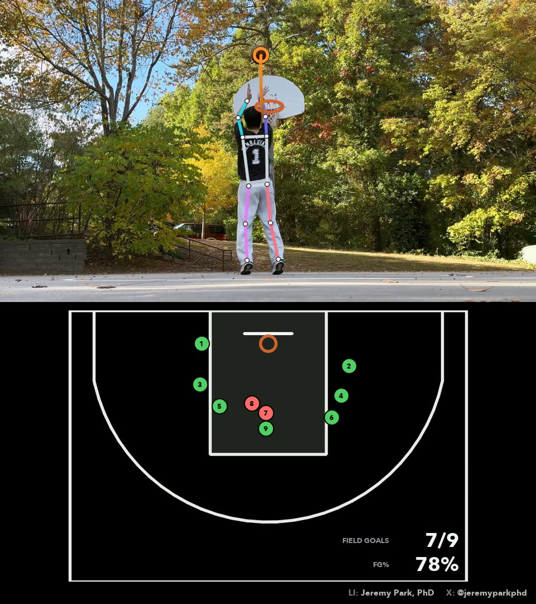

# basketball

Tracks a shooting session from a phone that stays still. It calls every shot a **make
or a miss** by following the ball through the rim, and plots each shot on a
**court seen from above** with a running field-goal percentage. Three makes in a
row set the ball and rim on fire. It also graphs the **shooting elbow** for
side-on shots.

Pose runs on
[`vitpose-plus-large`](https://vlm.run/gateway/models/usyd-community-vitpose-plus-large),
the hoop and ball on [`sam3.1`](https://vlm.run/gateway/models/facebook-sam3.1),
both through the [VLM Run Gateway](https://www.vlm.run/gateway). How it works:
[how-it-works.md](how-it-works.md).



## Run it

1. Get an API key at [app.vlm.run](https://app.vlm.run/sign-in) and put it in a `.env` at the repo root:

   ```bash
   cp ../.env.example ../.env   # then paste your key after VLMRUN_API_KEY=
   ```

2. Create the environment:

   ```bash
   conda env create -f environment.yml
   conda activate basketball
   ```

3. Put a clip in `data/input/`: landscape, the phone set down and still, with the hoop and the shooter in shot.

4. Run it:

   ```bash
   python main.py                         # every clip in data/input/
   python main.py data/input/session.mov  # one clip
   ```

   | flag | sets |
   |---|---|
   | `--height 1080` | the output's total height; the clip and the court below each take half |
   | `--hand right` | the shooting hand (default: auto) |
   | `--player-height 1.75` | the shooter's height in meters; scales court distances |
   | `--fov 70` | the camera's horizontal field of view |
   | `--yaw 0` | turns the court if the camera isn't square to the backboard |
   | `--three 6.75` | three-point radius: 6.75 FIBA, 7.24 NBA, 6.02 high school |
   | `--trim 10` | only the first 10 s |
   | `--fresh` | ignore cached replies |
   | `--li` `--x` `--ig` / `--no-credit` | a credit in the corner |

   Everything else is in [`config.py`](config.py).

## Output

Each run writes to `data/output/<timestamp>/`:

| file | what |
|---|---|
| `<clip>_basketball.mp4` | the video on top, field goals and the shot chart below |
| `plots.png` | every ball path at the hoop, and the shot chart |
| `elbow.png` | the elbow through each side-on shot, with a strip of frames per shot |
| `<clip>_shots.csv` | one row per shot |
| `<clip>_frames.csv` | one row per frame |
| `shots.json`, `run.json` | per-shot results with ball paths; settings and cost |

Model replies are cached in `data/cache/`, so re-runs don't call the models again.

## License

[Apache-2.0](../LICENSE).
