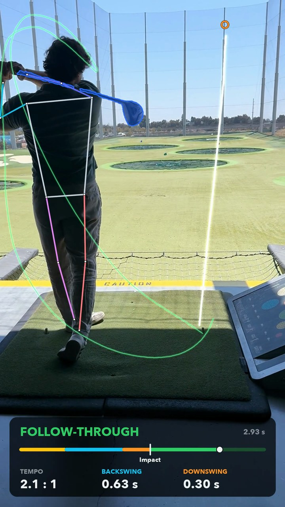

# golf

Breaks down one golf swing filmed from behind (down the line). It segments the
**club** on every frame and traces the **clubhead's path**, finds the **ball** on the
tee and for the frames it's visible after impact, projects the ball's **flight** past
that, and times the swing's **tempo**: backswing to downswing. Along the bottom of the
video, a live **timeline** follows the swing through its phases, with the tempo filling
in as it happens.

Pose runs on
[`vitpose-plus-large`](https://vlm.run/gateway/models/usyd-community-vitpose-plus-large),
the club and ball on [`sam3.1`](https://vlm.run/gateway/models/facebook-sam3.1),
both through the [VLM Run Gateway](https://www.vlm.run/gateway).

<p align="center">
  
</p>

## Run it

1. Get an API key at [app.vlm.run](https://app.vlm.run/sign-in) and put it in a `.env` at the repo root:

   ```bash
   cp ../.env.example ../.env   # then paste your key after VLMRUN_API_KEY=
   ```

2. Create the environment:

   ```bash
   conda env create -f environment.yml
   conda activate golf
   ```

3. Put a clip in `data/input/`: the phone still, behind the golfer, ball on the tee in shot.
4. Run:

   ```bash
   python main.py                            # every clip in data/input/
   python main.py data/input/swing.mov       # one clip
   ```

   | flag | sets |
   |---|---|
   | `--slowmo 3` | replay the whole swing 3× slower at the end (1 = no replay) |
   | `--trim 3` | only the first 3 s |
   | `--fresh` | ignore cached replies |
   | `--golfer "Name"` `--x` `--li` `--ig` / `--no-credit` | a credit strip along the bottom: the golfer on the left, your handles on the right |

   Everything else is in [`config.py`](config.py).

## How it works

- **Club.** SAM 3.1 tracks `"golf club"` through the clip in 128-frame calls. Its track
  ids aren't trusted: the club's id can hand over to the ball, and the club's mask often
  carries the ball, and its tee, as a second blob (sometimes joined to the clubhead by the
  tee). So per frame the club is the biggest mask held near the hands (ViTPose's wrists),
  with the ball and its tee cut out while the ball is on the tee. The **clubhead** is the
  end of the mask farthest from the hands.
- **Ball.** SAM 3.1 tracks `"golf ball"`; small round blobs from both prompts are
  candidates. The ball is followed at rest on the tee; the last frame there is impact.
  SAM then sees it for 2 frames in flight, until it's a few pixels wide. In the video,
  SAM's mask of the ball is drawn in orange on every frame SAM sees it, and a ring marks it
  on the tee and on every sighting in flight (the white trace stops short of the ring so
  the ball itself stays visible to check by eye).
- **Faint ball.** Past that, SAM finds nothing, even on an upscaled crop (here the ball
  also flies along a net pole). The phone only creeps (a few px a frame), so the ball is
  found by motion: each frame minus the median of frames 3–4 either side, each aligned to
  it sub-pixel first so the phone's jitter doesn't light up every edge. Every moving blob in a corridor ahead of
  the ball is a candidate, and the chain through them that best keeps the ball's motion
  (each step a bit shorter as it recedes, about the same direction) wins, over the whole
  sequence at once. On the sample swing that follows it 33 more frames, past the top of its
  arc in the frame, to frame 102 (1.2 s after impact).
- **Flight.** The trace is the sightings themselves. Only the stretch past the last one is
  **projected** (dashed), from a quadratic through the last dozen. The **start line** is the
  angle from the tee to the first sighting, against straight up the frame.
- **Ball speed, launch, carry (estimates).** The ball's size on the tee (42.7 mm against
  its median width in px over every frame it sits there) and the phone's focal length put
  the tee in 3D. A launch (speed, angle up, angle sideways, backspin, spin-axis tilt,
  moment of impact) is flown with gravity, drag and spin lift,
  projected through the phone, and fitted to every sighting, after taking out the phone's
  own drift (measured on the far scene). The fitted flight is flown on to landing for
  carry and apex. The phone's tilt comes from where the range's poles converge; the focal
  length from `CAMERA_SHORT_SIDE_FOV_DEG` (an iPhone 1x lens). It's re-fitted with the
  focal length ±10%, the tilt ±4°, the drag ±0.04 and the ball's width on the tee across
  its frame-to-frame wobble (10th–90th percentile), one at a time, and `run.json` keeps that
  range. On the sample swing: **81 mph** ball speed (76–87), **22°** launch (18–26),
  **102 yd** carry (91–113), a draw; the fit is within 2.2 px of the 35 sightings.
- **How far to trust them.** The range is a sensitivity sweep, not a confidence interval,
  and it isn't checked against a launch monitor. The ball's width on the tee sets the
  scale. A 1 px error there, from edge blur or the club sitting against the ball, moves
  the speed about 4%. The range allows for the width wobbling, not for it being
  consistently off, and the fit can't tell the difference. Carry is the weakest of the three: the ball is followed for 1.2 s of a ~3.8 s
  flight and the rest is flown. Spin is in `run.json` but not trusted: it trades off
  against the lift model. Everything here is tuned on, and shown on, one swing.
- **Phases and tempo.** Takeaway: the hands (then the clubhead) leave address. Top: the
  hands at their highest. Impact: from the ball. Tempo = backswing time ÷ downswing time.
  In the video, the swing has four phases: ADDRESS, BACKSWING (takeaway to top), DOWNSWING
  (top to impact) and FOLLOW-THROUGH. A playhead runs along a timeline split into those
  four, each in its own color (no words on it: the phase name above, and the backswing and
  downswing timers below, are in the same colors), with impact marked under it. The
  timeline covers half a second before takeaway to half a second after the finish, at one
  scale, so each phase's length on it is its real duration (the backswing visibly twice
  the downswing here). Under it the backswing and downswing times count up as they happen,
  and the tempo appears at impact.

There's no clubhead speed: at 30 fps the head moves up to ~900 px between frames,
blurred, partly toward the camera, so a 2D speed jumps around too much to trust.

## Output

`data/output/<timestamp>-swing/`:

| file | what |
|---|---|
| `<clip>_golf.mp4` | the clip with the overlay and the live timeline and tempo, then the whole swing again in slow-mo |
| `swing.png` | the address frame with the whole clubhead path and the ball's flight |
| `<clip>_frames.csv` | one row per frame: phase (finer than the video's: top and impact get a frame or two of their own), hands, clubhead, ball |
| `run.json` | settings, the swing's moments, the ball's sightings, the ball speed, launch and carry estimates (also printed in the terminal), cost |

Model replies are cached in `data/cache/`, so re-runs don't call the models again.
